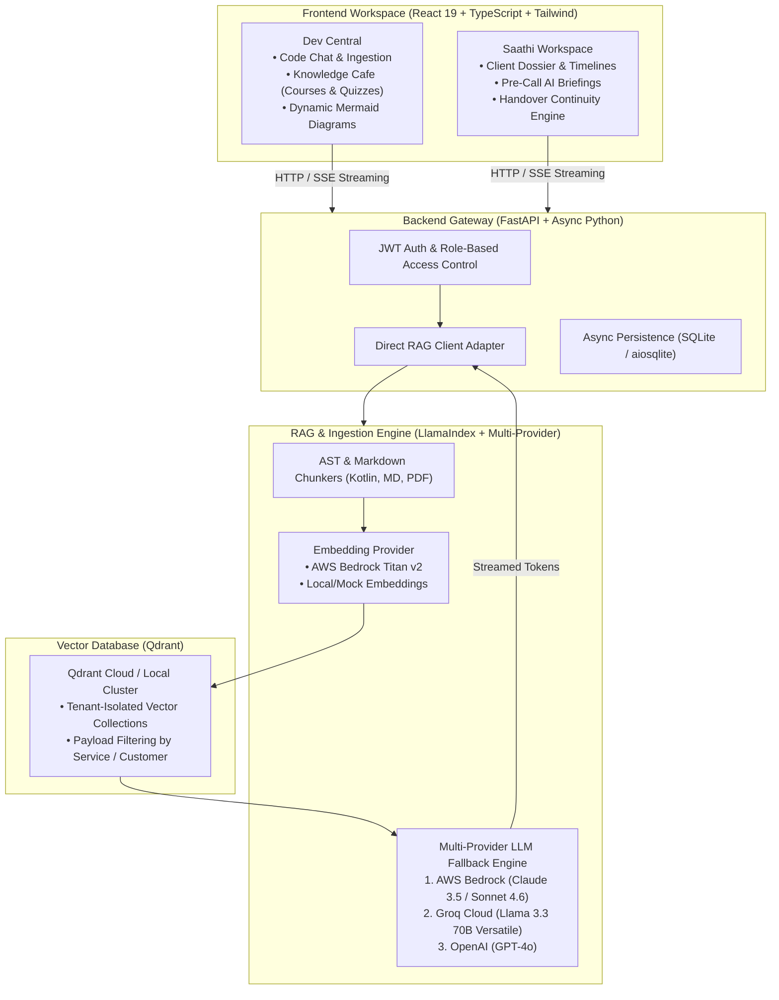

# ContextFoundry

> **Autonomous Engineering Intelligence & Context Continuity Platform**  
> *A high-performance, multi-tenant Retrieval-Augmented Generation (RAG) platform bridging technical microservice knowledge and organizational relationship memory.*

[](https://fastapi.tiangolo.com)
[](https://react.dev)
[](https://www.typescriptlang.org)
[](https://www.llamaindex.ai)
[](https://qdrant.tech)
[](https://www.docker.com)

---

## 🌟 Executive Overview

**ContextFoundry** is an enterprise-grade Knowledge Intelligence platform designed to solve the critical problem of tribal knowledge silos, slow developer onboarding, and lost operational context.

The platform provides two dedicated, persona-tailored workspaces powered by a unified RAG engine:

1. **Dev Central (Engineering Intelligence Hub)**:
   - **Interactive Microservice Chat**: Grounded Q&A against source code, APIs, and architectural decisions with exact markdown citations.
   - **Knowledge Cafe**: University-style interactive training courses featuring module syllabi, lesson progression, doubt-clearing AI assistants, and automated quizzes.
   - **Dynamic Architecture Diagrams**: Automatically generates interactive Mermaid sequence flows and entity diagrams from retrieved system context.
   - **Self-Service Ingestion**: Drag-and-drop document ingestion supporting PDF, Markdown, and source code.

2. **Saathi (Relationship Continuity Engine)**:
   - **Client Relationship Continuity**: Preserves institutional memory when advisors or relationship managers transition accounts.
   - **Pre-Call Briefings & Executive Summaries**: AI-synthesized client dossiers, risk profiles, open commitments, and past interaction timelines.
   - **Context Validation**: Customer validation workflow allowing clients to review and confirm relationship priorities.

---

## 🏛️ System Architecture



---

## 🚀 Key Technical Highlights

- **Multi-Provider LLM Resilience**: Dynamic multi-provider orchestration with automatic fallback between AWS Bedrock, Groq Cloud, and OpenAI to eliminate vendor lock-in and handle rate limits.
- **Tenant-Isolated Vector Storage**: Segmented retrieval pipelines utilizing Qdrant payload filters, guaranteeing strict isolation between services and customer dossiers.
- **Real-Time Token Streaming**: Server-Sent Events (SSE) streaming with low time-to-first-token (TTFT) and citation attribution.
- **Code & Markdown AST Parsing**: Custom chunkers that respect function boundaries and document section headers rather than splitting mid-token.
- **Clean Hexagonal Architecture**: Modular separation between Presentation, Application, Domain, and Infrastructure adapters.

---

## 🛠️ Technology Stack

| Layer | Technologies |
| :--- | :--- |
| **Frontend** | React 19, TypeScript, Vite, Tailwind CSS v4, Lucide Icons, Mermaid.js, React Markdown |
| **Backend API** | FastAPI, Python 3.12, Pydantic v2, Pydantic-Settings, aiosqlite, Uvicorn |
| **RAG & Search** | LlamaIndex Core, Qdrant Client, Groq SDK, Boto3 (Bedrock), PyPDF |
| **Vector DB** | Qdrant (Cloud / Local Container) |
| **DevOps & Containers** | Docker, Docker Compose, Nginx (Alpine) |

---

## ⚡ Quickstart Guide

### Option 1: One-Command Docker Compose (Recommended)

1. Clone the repository:
   ```bash
   git clone https://github.com/<your-username>/context-foundry.git
   cd context-foundry
   ```

2. Copy the environment template:
   ```bash
   cp .env.example .env
   # Add your GROQ_API_KEY (free tier available at console.groq.com)
   ```

3. Launch all services:
   ```bash
   docker compose up --build
   ```

4. Access the applications:
   - **Web UI**: [http://localhost:3000](http://localhost:3000)
   - **Backend API & Swagger Docs**: [http://localhost:8000/docs](http://localhost:8000/docs)
   - **Qdrant Vector Dashboard**: [http://localhost:6333/dashboard](http://localhost:6333/dashboard)

---

### Option 2: Local Development Setup

#### 1. Backend & RAG Service
```bash
# Set up Python virtual environment
python3 -m venv .venv
source .venv/bin/activate

# Install dependencies
pip install -r backend_service/requirements.txt
pip install -r rag_service/requirements.txt

# Configure environment
cp .env.example .env

# Run FastAPI backend
python -m uvicorn backend_service.app.main:app --reload --port 8000
```

#### 2. Frontend Service
```bash
cd frontend-service

# Install dependencies
npm install

# Start Vite dev server
npm run dev
# Accessible at http://localhost:5173
```

---

## 🧪 Quick Demo Logins

The application includes built-in demo credentials for quick persona exploration:

| Persona | Demo Email | Workspace | Description |
| :--- | :--- | :--- | :--- |
| **Software Engineer** | `engineer@contextfoundry.dev` | **Dev Central** | Explore architecture docs, ask RAG questions, and browse Knowledge Cafe courses. |
| **Client Advisor** | `advisor@contextfoundry.dev` | **Saathi** | Explore client dossiers, pre-call briefs, timeline records, and handover memory. |

---

## 💼 Portfolio Highlights & Resume Summary

> **ContextFoundry — Autonomous Engineering Intelligence & Multi-Tenant Knowledge Platform**
> - Architected a production-ready, dual-persona RAG platform serving software engineering teams and client relationship managers.
> - Implemented an intelligent multi-provider LLM orchestration layer (AWS Bedrock, Groq, OpenAI) with automatic fallback and sub-second token streaming.
> - Designed tenant-isolated vector retrieval with Qdrant, supporting structured AST-aware chunking of source code, Markdown, and technical specifications.
> - Built a responsive React 19 / TypeScript frontend featuring interactive courses, automated quizzes, live Markdown formatting, and automated Mermaid diagram rendering.
> - Containerized the entire multi-service stack using multi-stage Docker builds and Docker Compose for zero-friction local and cloud deployments.

---

## 📄 License

This project is licensed under the [MIT License](LICENSE).
